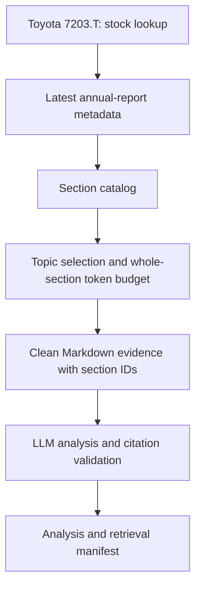

# Analyze Toyota's Annual Report with an LLM

Financial Report → DataSinking → Clean Markdown → LLM → Insights

**Don't feed a 300-page annual report to your LLM.** Retrieve relevant sections first. This is a workflow slogan, not a verified page count for Toyota's latest filing.

DataSinking provides full-text financial reports as clean Markdown and allows retrieving individual report sections, making it suitable for LLM and RAG applications.

This Python demo finds Toyota Motor Corporation (`7203.T`), chooses its latest available annual report by reporting period, retrieves selected business, strategy, risk, R&D and financial sections, and generates an English analysis with section citations. Japanese headings are supported.

**Current validation status:** offline checks pass; live DataSinking retrieval succeeded on 2026-10-06. OpenAI API generation remains unverified because no OpenAI key was provided. See docs/live_run.md. `output/example_analysis.md` is a clearly labeled structure example, not fabricated Toyota research. API list/section schema variants fail explicitly when unsupported.

## Architecture / workflow



No full-report endpoint is called without a section filter. Toyota currently exposes a broad enterprise-information chapter; `--allow-broad-section` explicitly enables broad retrieval followed by local subsection selection. This reduces model context, not necessarily download volume. Oversized sections are skipped intact, preserving table and unit context. Missing evidence is reported, never filled using model knowledge.

## Installation

Python 3.10+ recommended. From the downloaded project directory:

```bash
python -m venv .venv
# macOS / Linux
source .venv/bin/activate
# Windows PowerShell: .venv\Scripts\Activate.ps1
python -m pip install -r requirements.txt
```

## Environment configuration

```bash
# macOS / Linux
cp .env.example .env
# Windows PowerShell: Copy-Item .env.example .env
```

Fill in `.env` locally:

```dotenv
DATASINK_API_KEY=your_datasinking_key
OPENAI_API_KEY=your_openai_key
OPENAI_MODEL=gpt-4.1-mini
```

Get a DataSinking key from [DataSinking](https://datasink.ing/). Keys are never embedded in source; `.env` and generated report content are ignored by Git. API errors suppress URL/response details because DataSinking authenticates REST requests via query parameters. Avoid HTTP debug logging.

## Running the demo

```bash
python demo.py --self-check
python demo.py --retrieve-only
# For Toyota catalogs exposing only the broad enterprise chapter:
python demo.py --retrieve-only --allow-broad-section --max-input-tokens 60000
python demo.py
python demo.py --max-sections 6 --max-input-tokens 32000
```

`--retrieve-only` needs only `DATASINK_API_KEY`. Normal analysis needs both keys and incurs API/model usage. Run commands from the project folder. Paths resolve relative to the script, not the shell working directory.

Outputs (local, ignored by Git):

- `output/analysis.md`: English analysis with eight required topics and citations.
- `output/selected_sections.md`: exact selected evidence for auditing.
- `output/retrieval_manifest.json`: report identity, catalog, selected/skipped sections, hashes, token estimate, and actual model usage when returned.

If no suitable sections fit, increase the budget or extend `TOPICS` in `src/retrieval.py`. The demo does not truncate financial tables or silently download the whole report. Latest means latest available **reporting period in DataSinking**, not guaranteed newest disclosure worldwide. Topic matching is deterministic heading retrieval, not semantic vector search.

## Example output

See [the labeled output structure](output/example_analysis.md). Real output contains:

> **Fact:** a financial metric, with its exact currency/scale and reporting period, followed by a supporting section citation.
> **Interpretation:** an inference grounded in the cited evidence.

The prompt requires `Not found in the provided report sections` when evidence is absent. No real metric or report identity is invented for this example.

## Why section-level retrieval matters

Fetching a relevant chapter avoids sending unrelated chapters to the model and preserves structured Markdown tables. The complete evidence plus instructions must fit the configurable token budget. Whole sections that exceed it are skipped and recorded. This can reduce context size, cost and irrelevant context; **this repository makes no measured savings claim** and does not fetch full text merely to calculate a marketing percentage. Actual request usage is recorded after a live run.

## DataSinking API explanation

Uses the documented REST API with `requests`; the official SDK's published quickstart lists general report operations, so REST exposes section retrieval directly without guessing SDK methods.

| Step | Request | Purpose |
| --- | --- | --- |
| Company lookup | `GET /stocks?exchange=jpx` | Match exact `7203.T` symbol |
| Annual reports | `GET /documents?symbol=7203.T&doc_type=annual&order=desc&size=1` | Metadata only; latest by reporting period |
| Catalog | `GET /documents/{id}/sections` | Read headings |
| Section | `GET /documents/{id}?section=<title>` | Retrieve selected clean Markdown |

All requests include `apikey` privately through environment configuration. `requests` encodes Japanese titles. Section matching is fuzzy on the server; check saved evidence before relying on figures. The client spaces requests and retries rate-limit/server failures. It rejects unsupported response shapes rather than guessing evidence.

Official references: [API docs](https://datasink.ing/docs), [OpenAPI specification](https://api.datasink.ing/openapi.json). Docs reviewed 2026-10-06; the machine-readable spec could not be fetched in the build environment. Live schema compatibility therefore remains to be confirmed with a key.

## RAG explanation

Retrieval-augmented generation supplies retrieved evidence before generating an answer. Here, report metadata and heading relevance choose chapters, which become the model's evidence context. A vector database is unnecessary for this single-report demo. A multi-company extension could split sections while preserving headers/units, index embeddings, retrieve relevant chunks, and attach document/section IDs to each chunk.

Citation validation catches absent/unknown citation IDs and missing headings. It **does not prove every factual claim is correct**; verify excerpts and financial units against evidence.

## MCP extension

MCP (Model Context Protocol) exposes retrieval tools to compatible AI agents. DataSinking documents a hosted MCP server and a local package, including a `get_section` tool. This repository uses REST, not MCP. See [MCP extension notes](docs/mcp.md) for a private environment-variable configuration. Do not commit a key-bearing hosted MCP URL.

## Disclaimer

Developer demonstration, not investment advice. AI-generated interpretation can be wrong. Preserve units and distinguish targets from results; verify material figures against official Toyota disclosures. DataSinking coverage, report availability and API contracts may change. Check provider terms and report rights before redistributing report content. Generated evidence is excluded from Git by default.

## Contributing and publishing

Run `python demo.py --self-check` before contributing. See [workflow](docs/workflow.md), [validation](docs/validation.md), and [launch copy](docs/promotion.md). Upload this project folder to a new GitHub repository named `toyota-annual-report-llm`; review staged files with `git diff --cached` before pushing. No remote repository was created during preparation.
